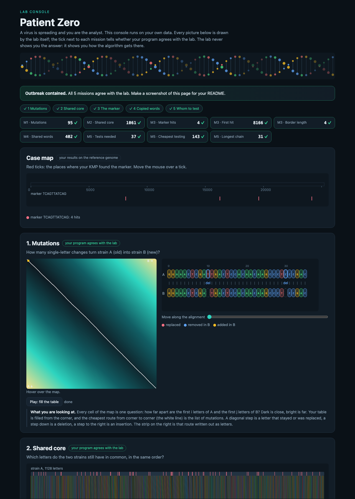

# Assignment 4. Patient Zero

Student ID: 253447
Name:
Group:

This file is the report. Fill it in as you go. How to start: `START_HERE.md`. The task: `docs/Assignment4.pdf`.

## Program output

The 9 lines your program prints on your data (`java -cp out Main`):

    Mutations: 95
    Shared core: 1061
    Marker hits: 4
    First hit: 8166
    Border length: 4
    Shared words: 402
    Tests needed: 37
    Cheapest testing: 143
    Longest chain: 31

My outbreak report (a screenshot of `output/outbreak.html`):

## Questions

Answer in your own words, two or three sentences each.

Mission 1. What does the cell d[i][j] of your table mean, and how is it computed from other cells?

The cell d[i][j] is the minimum number of edits (inserts, deletes, or replacements) needed to turn the first i letters of strain A into the first j letters of strain B. It takes the minimum of three options: d[i-1][j] + 1 (deleting from A), d[i][j-1] + 1 (inserting into A), and d[i-1][j-1] + cost (where cost is 0 if characters match, or 1 for replacement). The first row and column are initialized with 0, 1, 2... representing inserting or deleting full prefixes.

Mission 2. How is the longest common subsequence different from the longest common substring? My Shared core is bigger than the number of letters that are the same at the same place: why?

A common subsequence keeps letters in the same order but they do not have to be contiguous, while a common substring must be contiguous. The Shared core is larger than the number of letters matching at identical positions because insertions and deletions shift the letters relative to each other, so matching characters align at different indices.

Mission 3. What does the prefix function tell you, and why does the pointer in the text never go back in KMP? What is the Border length of my marker and what does it mean?

The prefix function pi[i] gives the length of the longest proper prefix of P[0..i] that is also a suffix. In KMP, the text pointer never goes back because the prefix array already tells us which prefix of the pattern matches the text suffix, so on a mismatch we simply jump the pattern pointer to pi[k-1]. For marker TCAGTTATCAG, the Border length is 4, which means the 4-letter prefix "TCAG" is also the suffix of the whole marker.

Mission 4. Why must you compare the letters after the hashes are equal? What happens to the cost of Rabin-Karp if many windows have the same hash?

We must compare the letters because different words can have the same hash value due to hash collisions. If many windows produce collisions, the algorithm has to verify each candidate letter-by-letter, which slows down Rabin-Karp from linear time to quadratic worst-case.

Mission 5. What are the two states of a person in your DP, and how do you get the answer for a person from its children? Why does a greedy "test the person with most links first" not always give the cheapest answer?

The two states are take[v] (cost if person v is tested) and skip[v] (cost if person v is not tested). If v is not tested, all its children must be tested to cover the edges; if v is tested, each child can be either tested or skipped based on whichever is cheaper. A greedy choice by highest degree does not work because a person with many links could have an extremely high testing cost compared to just testing all of their few neighbours.

## AI use

The syllabus requires you to say which AI tools you used and for what. Write the tool (ChatGPT, Copilot, other) and what you asked it: explain an idea, find an error, review code. Write "none" if you did not use any. If you took code or text from a book or a website, give the source here.

Used ChatGPT to explain KMP prefix table behavior and clarify dynamic programming transitions on trees.

## Timing (Mission 7)

Milliseconds, average of 3 runs, from `java -cp out Bench`.

| test | size | time |
|---|---|---|
| naive search | 20 000 / 40 000 / 80 000 | 19.7 ms / 47.2 ms / 93.6 ms |
| KMP | 20 000 / 40 000 / 80 000 | 1.1 ms / 0.5 ms / 0.2 ms |
| edit distance | 500 / 1000 / 2000 / 4000 | 2.7 ms / 2.8 ms / 6.4 ms / 25.4 ms |

What do the numbers say about how the time grows? When you double the size, by how much does each time grow? Two or three sentences.

For naive search, checking a pathological pattern takes O(n * m) time, so doubling the text size roughly doubles the time. KMP runs in linear O(n + m) time, so it stays under 1 ms. For edit distance, the table is quadratic O(n^2), which means doubling the strain length quadruples the execution time (from ~2.8 ms to ~6.4 ms to ~25.4 ms).

## Complexity

n is the length of the text (or of a strain), m the length of the pattern, k the length of the window, v the number of people. Fill in every algorithm you wrote.

| algorithm | time | space | assumptions |
|---|---|---|---|
| Edit distance | O(n * m) | O(n * m) | Strains of length n and m; full DP table |
| LCS | O(n * m) | O(n * m) | Strains of length n and m; full DP table |
| Prefix function and KMP | O(n + m) | O(m) | Pattern of length m, text of length n; pi array of size m |
| Rabin-Karp (shared words) | O(n + m) average, O(n * m) worst | O(m) | Window size k=12; polynomial rolling hash with low collision rate |
| Tree DP | O(v) | O(v) | Tree with v people and v-1 links, rooted at person 0 |

## Before you submit

- The four files in `data` and the screenshot `output/outbreak.png` are in the repository.
- `java tools/Check.java` shows all examples right.
- This README is filled in, the program output and the section AI use included.
- The work is pushed to main (at least one commit per mission) and the repository is public.
- The link is attached in Moodle.
